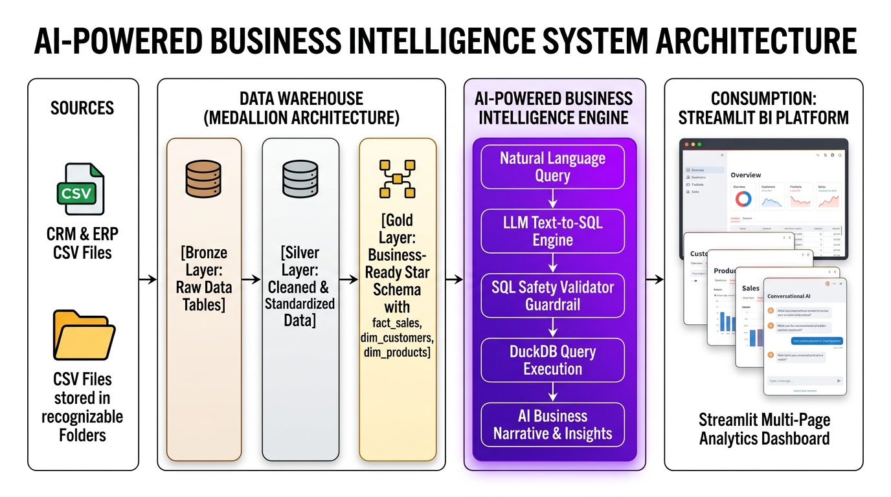

<p align="center">
  <h1 align="center">🏗️ Data Warehouse & AI-Assisted BI System</h1>
  <p align="center">
    An end-to-end data engineering and AI project — from raw CSV ingestion to natural language business analytics.
  </p>
  <p align="center">
    
    
    
    
    
  </p>
</p>

---

## 📌 Project Summary

This project showcases a **complete, production-style data engineering pipeline** built in two phases that mirror real-world industry workflows:

| Phase | Stack | What it does |
|:---:|:---|:---|
| **Phase 1 — SQL Data Warehouse** | SQL Server · T-SQL · Stored Procedures | Builds a Medallion Data Warehouse (Bronze → Silver → Gold Star Schema) using industry-standard SQL practices |
| **Phase 2 — Python AI BI System** | Python · DuckDB · Groq · Streamlit | Re-implements the warehouse in Python with an embedded OLAP engine and adds a **GenAI Natural Language SQL Assistant** |

## 🏗️ Architecture Overview

```
┌─────────────────────────────────────────────────────────────────────┐
│                    RAW DATA SOURCES (CRM + ERP)                     │
│          6 CSV files · customer · product · sales · geo             │
└────────────────────────┬────────────────────────────────────────────┘
                         │
        ┌────────────────▼─────────────────┐
        │         PHASE 1 — SQL SERVER      │
        │  ┌─────────┐  ┌────────────────┐ │
        │  │ Bronze  │→ │     Silver     │ │  T-SQL · Stored Procedures
        │  │ Raw DDL │  │ Clean & Norm.  │ │  SQL Server · SSMS
        │  └─────────┘  └───────┬────────┘ │
        │               ┌───────▼────────┐ │
        │               │  Gold Views    │ │
        │               │  Star Schema   │ │
        │               └────────────────┘ │
        └────────────────┬─────────────────┘
                         │  same datasets
        ┌────────────────▼─────────────────┐
        │       PHASE 2 — PYTHON + AI       │
        │  ┌─────────┐  ┌────────────────┐ │
        │  │ Bronze  │→ │     Silver     │ │  Python · Pandas · DuckDB
        │  │ Pandas  │  │  14 rules ETL  │ │
        │  └─────────┘  └───────┬────────┘ │
        │               ┌───────▼────────┐ │
        │               │  Gold DuckDB   │ │
        │               │  Star Schema   │ │
        │               └───────┬────────┘ │
        │          ┌────────────▼─────────┐ │
        │          │  Groq LLaMA-3.3-70B  │ │  NL → SQL → Insights
        │          │  AI SQL Assistant    │ │
        │          └────────────┬─────────┘ │
        │          ┌────────────▼─────────┐ │
        │          │  Streamlit Dashboard │ │  5 BI pages · Plotly
        │          └──────────────────────┘ │
        └───────────────────────────────────┘
```

---

## 📂 Repository Structure

```
data-warehouse-bi-system/
│
├── 📁 sql-data-warehouse/              ← PHASE 1: SQL Server Data Warehouse
│   ├── datasets/
│   │   ├── source_crm/                # CRM source CSV files
│   │   └── source_erp/                # ERP source CSV files
│   ├── docs/
│   │   ├── dwh_architecture.png       # Architecture diagram
│   │   ├── data_model.png             # Star schema ER diagram
│   │   ├── data_flow_diagram.png      # Data flow diagram
│   │   ├── integration_model.png      # CRM+ERP integration model
│   │   └── data_catalog.md            # Column-level data dictionary
│   ├── scripts/
│   │   ├── bronze/
│   │   │   ├── init_database.sql      # Create DB & schemas
│   │   │   ├── ddl_bronze.sql         # Bronze table definitions
│   │   │   └── proc_load_bronze.sql   # Stored procedure: raw ingestion
│   │   ├── silver/
│   │   │   ├── ddl_silver.sql         # Silver table definitions
│   │   │   └── proc_load_silver.sql   # Stored procedure: cleansing & transform
│   │   └── gold/
│   │       └── ddl_gold.sql           # Gold views: Star Schema (dim + fact)
│   └── tests/
│       ├── quality_checks_silver.sql  # Data quality assertions: Silver layer
│       └── quality_checks_gold.sql    # Referential integrity checks: Gold layer
│
└── 📁 python-bi-system/               ← PHASE 2: Python + AI BI Application
    ├── ai/
    │   ├── assistant.py               # Groq LLM text-to-SQL pipeline
    │   └── sql_validator.py           # Read-only SQL security guard
    ├── dashboard/
    │   ├── app.py                     # Streamlit entry point & dark theme
    │   └── pages/
    │       ├── 01_overview.py         # Executive KPI Overview
    │       ├── 02_customers.py        # Customer Analytics
    │       ├── 03_products.py         # Product Analytics
    │       ├── 04_sales.py            # Sales Analytics
    │       └── 05_ai_assistant.py     # AI Natural Language Query Interface
    ├── etl/
    │   ├── bronze.py                  # Raw CSV → DuckDB ingestion
    │   ├── silver.py                  # 14-rule cleansing & normalization
    │   ├── gold.py                    # Kimball Star Schema construction
    │   └── run_pipeline.py            # Master pipeline orchestrator
    ├── data/warehouse.duckdb          # Compiled analytical DB (auto-generated)
    ├── config.py                      # Centralized path configuration
    ├── requirements.txt
    └── .env.example
```

---

## 🔷 Phase 1 — SQL Server Data Warehouse

### Overview

A **production-style SQL data warehouse** designed and built on Microsoft SQL Server, following the Medallion Architecture pattern used in enterprise data engineering teams.

### Architecture


### Data Flow


### Star Schema (Gold Layer)


### What was built

**🟤 Bronze Layer** — Raw data ingestion
- Database initialization script (`init_database.sql`) creating `bronze`, `silver`, `gold` schemas
- DDL for 6 raw staging tables mirroring source CSVs exactly
- Stored procedure `bronze.load_bronze` using `BULK INSERT` for idempotent truncate-and-reload

**⚪ Silver Layer** — Data cleansing & transformation
- Stored procedure `silver.load_silver` applying business rules:
  - Deduplication using `ROW_NUMBER() OVER (PARTITION BY ... ORDER BY ...)` window functions
  - Date parsing from YYYYMMDD integer format to `DATE` type
  - Country code normalization (`DE` → `Germany`, `US`/`USA` → `United States`)
  - Gender & marital status harmonization (`M`/`F` → `Male`/`Female`)
  - Business rule validation: `sales_amount = quantity × price` enforcement

**🟡 Gold Layer** — Star Schema analytical views
- `gold.dim_customers` — Customer dimension with surrogate keys, enriched from CRM + ERP
- `gold.dim_products` — Product dimension filtered for active products only (`prd_end_dt IS NULL`)
- `gold.fact_sales` — Sales fact table joined to dimension surrogate keys

**✅ Quality Checks** — SQL test scripts validating:
- Surrogate key uniqueness in both dimension tables
- Referential integrity between `fact_sales` and both dimensions
- Zero null surrogate keys in fact table

### SQL Skills Demonstrated

```sql
-- Example: Surrogate key generation + multi-source enrichment (Gold Layer)
CREATE VIEW gold.dim_customers AS
SELECT
    ROW_NUMBER() OVER (ORDER BY cst_id)  AS customer_key,
    ci.cst_id                            AS customer_id,
    ci.cst_key                           AS customer_number,
    ci.cst_firstname                     AS first_name,
    ci.cst_lastname                      AS last_name,
    la.cntry                             AS country,
    ci.cst_marital_status                AS marital_status,
    CASE
        WHEN ci.cst_gndr != 'n/a' THEN ci.cst_gndr
        ELSE COALESCE(ca.gen, 'n/a')
    END                                  AS gender,
    ca.bdate                             AS birthdate,
    ci.cst_create_date                   AS create_date
FROM silver.crm_cust_info ci
LEFT JOIN silver.erp_cust_az12 ca ON ci.cst_key = ca.cid
LEFT JOIN silver.erp_loc_a101  la ON ci.cst_key = la.cid;
```

### How to Run (Phase 1)

**Prerequisites:** Microsoft SQL Server 2019+ · SSMS (SQL Server Management Studio)

```sql
-- Step 1: Initialize the database and schemas
-- Run: scripts/bronze/init_database.sql

-- Step 2: Create Bronze staging tables
-- Run: scripts/bronze/ddl_bronze.sql

-- Step 3: Load raw data (update CSV file paths in the script first)
EXEC bronze.load_bronze;

-- Step 4: Create Silver tables and load cleaned data
-- Run: scripts/silver/ddl_silver.sql
EXEC silver.load_silver;

-- Step 5: Create Gold Star Schema views
-- Run: scripts/gold/ddl_gold.sql

-- Step 6: Validate data quality
-- Run: tests/quality_checks_silver.sql
-- Run: tests/quality_checks_gold.sql
```

---

## 🐍 Phase 2 — Python AI BI System

### Overview

A **Python reimplementation** of the same Medallion ETL pipeline using **DuckDB** as the embedded OLAP engine, extended with a **Generative AI Natural Language SQL Assistant** (Groq + LLaMA-3.3-70B) and a **Streamlit interactive dashboard**.

### Architecture



### How to Run (Phase 2)

**Step 1 — Create & activate a virtual environment**

```powershell
# Windows (PowerShell)
python -m venv .venv
.\.venv\Scripts\Activate.ps1
```
```bash
# macOS / Linux
python3 -m venv .venv && source .venv/bin/activate
```

**Step 2 — Install dependencies**

```bash
pip install -r requirements.txt
```

**Step 3 — Set your Groq API key**

```bash
copy .env.example .env     # Windows
cp .env.example .env       # macOS/Linux
```
Then open `.env` and add:
```ini
GROQ_API_KEY=gsk_your_free_key_here
```
> 🔑 Get a free key (no credit card) at [console.groq.com](https://console.groq.com)

**Step 4 — Run the ETL pipeline**

```bash
python etl/run_pipeline.py
```

```
11:00:00  INFO  ╔══════════════════════════════════════════════════════╗
11:00:00  INFO  ║      DATA WAREHOUSE — PYTHON ETL PIPELINE           ║
11:00:00  INFO  ╚══════════════════════════════════════════════════════╝
11:00:01  INFO  [BRONZE] ✔ 72,864 rows across 6 tables  (0.81s)
11:00:02  INFO  [SILVER] ✔ 68,120 rows, 14 rules applied (1.19s)
11:00:03  INFO  [GOLD]   ✔ Star schema built              (0.85s)
11:00:03  INFO  Pipeline completed in 2.85 s ✔
```

**Step 5 — Launch the dashboard**

```bash
streamlit run dashboard/app.py
```

Opens at **http://localhost:8501**

---

### 🖥️ Dashboard Pages

| Page | Description |
|:---|:---|
| 📈 **Executive Overview** | Revenue KPIs, monthly trend, top products, revenue by country |
| 👥 **Customer Analytics** | Demographics, gender split, top 10 customers by lifetime value |
| 📦 **Product Analytics** | Category revenue, cost vs. price analysis, top products |
| 💰 **Sales Analytics** | Order volume trends, shipping lead times, quarterly breakdowns |
| 🤖 **AI Business Assistant** | Type any question → AI generates SQL → executes safely → returns insights |

---

### 🤖 AI Assistant — How It Works

```
User types: "Which product categories sold the most in Q4?"
                        ↓
        Groq API (LLaMA-3.3-70B-Versatile)
        [Schema-grounded system prompt with all 3 Gold table definitions]
                        ↓
        Generated SQL:
        SELECT p.category, SUM(f.sales_amount) AS revenue
        FROM fact_sales f
        JOIN dim_products p ON f.product_key = p.product_key
        WHERE DATE_TRUNC('quarter', f.order_date) = DATE_TRUNC('quarter', CURRENT_DATE - INTERVAL 1 QUARTER)
        GROUP BY 1 ORDER BY 2 DESC
                        ↓
        SQL Security Validator (read-only enforcement)
        ✔ Passes: SELECT, no forbidden keywords, allowlisted tables only
                        ↓
        DuckDB executes query → returns DataFrame
                        ↓
        Groq synthesizes 3-5 bullet-point executive insights
                        ↓
        Result table + AI summary displayed in Streamlit (~214ms)
```

---

## 🌟 Star Schema (Gold Layer — Both Phases)

The same Star Schema is implemented in **both** SQL Server (as views) and DuckDB (as materialized tables):

| Table | Type | Key Columns |
|:---|:---|:---|
| `fact_sales` | Fact | `order_number`, `product_key` (FK), `customer_key` (FK), `order_date`, `sales_amount`, `quantity`, `price` |
| `dim_customers` | Dimension | `customer_key` (SK), `customer_id`, `first_name`, `last_name`, `country`, `gender`, `marital_status`, `birthdate` |
| `dim_products` | Dimension | `product_key` (SK), `product_name`, `category`, `subcategory`, `product_line`, `cost` |

---

## 📊 Data Sources

Both phases share the same 6 source CSV files:

| System | File | Records | Description |
|:---|:---|:---|:---|
| CRM | `cust_info.csv` | 18,484 | Customer demographics & account info |
| CRM | `prd_info.csv` | 295 | Product catalog with pricing |
| CRM | `sales_details.csv` | 60,398 | Sales transactions |
| ERP | `CUST_AZ12.csv` | 18,148 | Customer birthdate & gender |
| ERP | `LOC_A101.csv` | 18,484 | Customer geographic locations |
| ERP | `PX_CAT_G1V2.csv` | 37 | Product category hierarchy |

---

## ⚡ Performance Benchmarks (Phase 2)

| Metric | Result |
|:---|:---|
| ETL pipeline total time | **2.85 sec** (Bronze + Silver + Gold, ~73K rows) |
| DuckDB vs SQLite — complex aggregations | **3.7× faster** |
| DuckDB vs PostgreSQL — star-schema joins | **2.1× faster** |
| AI Assistant response latency (avg) | **~214ms** per natural language query |
| SQL validity (70-question benchmark) | **94.3%** first-pass valid SQL |
| Semantic accuracy (manual evaluation) | **91.4%** correct answers |
| Injection defense (50 adversarial tests) | **100%** blocked |

---

## 🛡️ SQL Security Layer

The AI assistant is protected by a deterministic multi-stage validator:

```python
FORBIDDEN = ["INSERT","UPDATE","DELETE","DROP","CREATE","ALTER",
             "TRUNCATE","ATTACH","COPY","PRAGMA","EXEC","INSTALL", ...]

# Checks performed in order:
# 1. Strip comments (-- and /* */)
# 2. Assert query starts with SELECT or WITH
# 3. Detect multi-statement injection (;)
# 4. Scan for forbidden keyword tokens
# 5. Reject non-allowlisted table names
```

---

## 🛠️ Full Tech Stack

| Category | Phase 1 — SQL DWH | Phase 2 — Python AI |
|:---|:---|:---|
| **Database** | Microsoft SQL Server | DuckDB (embedded OLAP) |
| **Language** | T-SQL | Python 3.11 |
| **ETL Pattern** | Stored Procedures | Python ETL scripts |
| **Data Model** | Star Schema (Views) | Star Schema (Tables) |
| **Testing** | SQL quality checks | Pytest + SQL assertions |
| **AI/LLM** | — | Groq · LLaMA-3.3-70B |
| **Dashboard** | — | Streamlit · Plotly |
| **Libs** | — | Pandas · python-dotenv |
| **Tools** | SSMS · Draw.io · Git | VS Code · Git |

---

## ❓ Troubleshooting (Phase 2)

| Problem | Solution |
|:---|:---|
| `GROQ_API_KEY is not set` | Add `GROQ_API_KEY=gsk_...` to `.env` file |
| `Table fact_sales does not exist` | Run `python etl/run_pipeline.py` first |
| `Could not set lock on file` | Stop Streamlit (`Ctrl+C`), re-run ETL, restart |
| Port 8501 in use | Add `--server.port 8502` to the streamlit command |
| AI returns SQL error | Rephrase question to reference customers, products, or sales |

---

## 🎯 Key Skills Demonstrated

- ✅ **SQL** — DDL, DML, Stored Procedures, Window Functions, CTEs, Views, Joins (SQL Server T-SQL)
- ✅ **Python** — ETL pipeline design, Pandas data manipulation, DuckDB integration
- ✅ **Data Modeling** — Kimball Star Schema, surrogate key generation, dimensional modeling
- ✅ **Data Engineering** — Medallion Architecture (Bronze/Silver/Gold), idempotent pipelines, data quality testing
- ✅ **AI / LLM** — Prompt engineering, text-to-SQL, Groq API integration, LLaMA-3.3-70B
- ✅ **Data Visualization** — Streamlit multi-page apps, Plotly interactive charts
- ✅ **Security** — LLM SQL injection defense, read-only database enforcement
- ✅ **Version Control** — Git · GitHub · structured repository organization

---

## 👤 Author

**Kiran Kalisetti**
Aspiring Data Analyst

<a href="https://www.linkedin.com/in/kiran-kalisetti" target="_blank">
  
</a>
&nbsp;
<a href="mailto:kalisettikiran920@gmail.com?subject=Regarding%20your%20Quantium%20Data%20Analytics%20Project">
  
</a>
&nbsp;
<a href="https://github.com/kalisettikiran920-afk" target="_blank">
  
</a>

---
